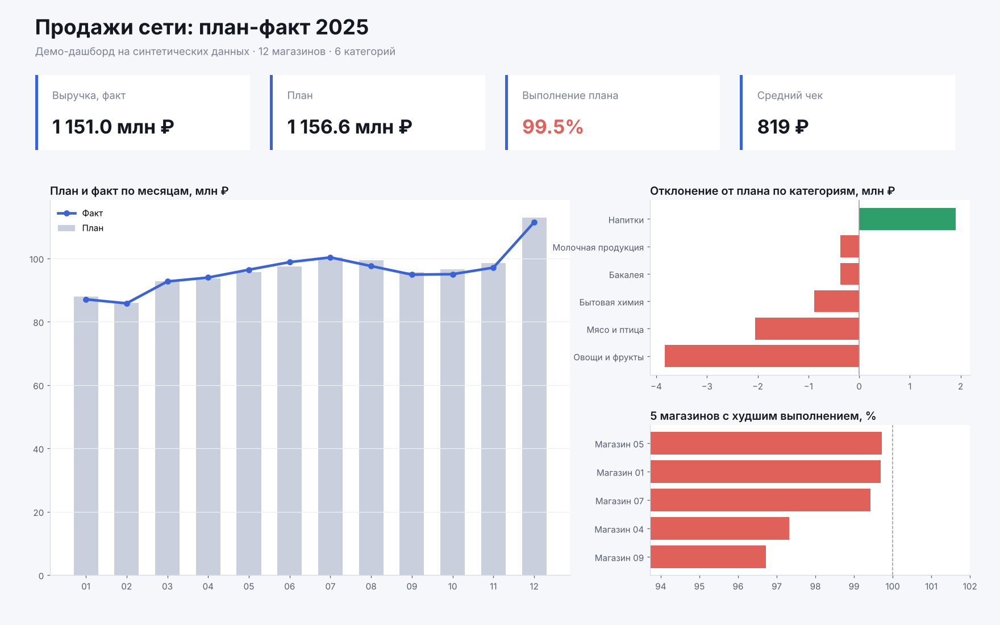
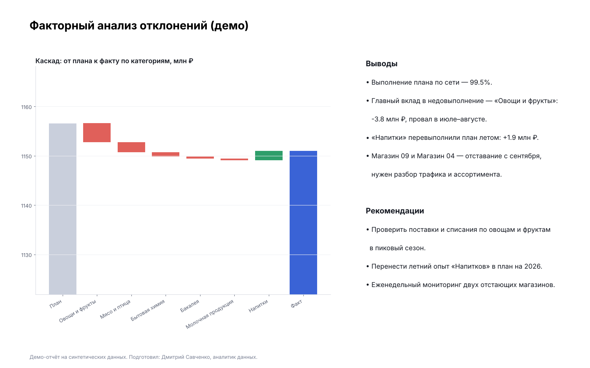

# Портфолио: аналитик данных

## Обо мне

Привет! Меня зовут Дмитрий Савченко. Я аналитик данных с практическим опытом: работаю с отчётностью и аналитикой в крупной рознице, автоматизирую расчёты в Excel и строю дашборды в Power BI. Ищу удалённую работу и проекты в аналитике (продуктовая аналитика, AI-решения, BI).

В репозитории — услуги, демо-работы на синтетических данных, учебные проекты и мои кейсы. В кейсах реальные суммы заменены индексами и долями.

## Навыки и технологии
- Анализ данных: `SQL`, `Excel` (Power Query, сводные таблицы, макросы `VBA`)
- Языки и библиотеки: `Python`, `Pandas`, `math`
- Базы данных: `MySQL`, `PostgreSQL`
- Визуализация и BI: `Power BI`, `DAX`, `Matplotlib`, `seaborn`
- Подход: план-факт и факторный анализ, юнит-экономика, когортный анализ, автоматизация отчётности

---

## Услуги (Kwork)

### 1. Создам дашборд в Power BI
KPI, план-факт, динамика и фильтры — на одном экране. Инструменты: Power BI, DAX, Power Query, Excel / Google Sheets.

### 2. Автоматизирую отчёт в Excel
Обновление одной кнопкой вместо ручной сводки. Инструменты: Power Query, сводные таблицы, макросы VBA, дашборд.

### 3. Анализ данных: план-факт и выводы
Найду отклонения, причины и точки роста: где отклонения от плана, какие факторы повлияли, что делать дальше. Инструменты: Excel, SQL, Python, статистика.

---

## Демо-работы (синтетические данные)

### Демо 1. Дашборд «Продажи сети: план-факт 2025»
12 магазинов, 6 категорий. Показатели: выручка, план, выполнение плана, средний чек. Графики: план и факт по месяцам, отклонение от плана по категориям, пять магазинов с худшим выполнением.

### Демо 2. Факторный анализ отклонений
Каскад от плана к факту по категориям с выводами и рекомендациями.

- Выполнение плана по сети — 99,5%.
- Главный вклад в недовыполнение — «Овощи и фрукты»: −3,8 млн ₽, провал в июле–августе.
- «Напитки» перевыполнили план летом: +1,9 млн ₽.
- Два магазина отстают с сентября, нужен разбор трафика и ассортимента.

Полный отчёт: [demo_report.pdf](demo_report.pdf)

---

## Кейсы

### Кейс 1. Автоматизация учёта в Excel
**Задача.** Многолетний учёт с недельной детализацией и годовой сводкой не масштабировался: данные вносились вручную, формулы расходились между годами.

**Что сделал.**
- Расширил таблицу на новый период, перенёс формулы и оформление без ручной правки.
- Проверил годовые суммы и нашёл ошибку: в итоговой формуле пропускался один из месяцев.
- Добавил лист «Пояснения»: допущения, открытые вопросы, правила разнесения операций по категориям.

**Результат.** Единая таблица с корректными итогами за все периоды. Инструменты: Excel, openpyxl, LibreOffice.

### Кейс 2. Динамика доходов и структура расходов
**Задача.** Понять, как менялся доход за пять лет, из чего он состоит и куда уходят деньги.

**Что сделал.**
- Свёл годовые показатели в единую динамику (индекс: первый год = 100).
- Разделил доходы на активные, пассивные и от бизнеса, оценил долю пассивной части.
- Выделил статьи расходов и нашёл главную проблему данных: значительная часть операций не имела категории.

**Результат.** Рост дохода примерно в 5 раз за пять лет, пассивная часть порядка пятой доли. Рекомендация: обязательная категория для каждой операции и отдельный учёт наличных. Инструменты: Excel, Power BI.

### Кейс 3. Единая методика оценки доходности активов
**Задача.** Сравнить разнородные вложения (вклад, недвижимость, транспорт, малый бизнес) по одному правилу.

**Что сделал.**
- Ввёл формулу: доходность = чистый денежный поток за год / собственные вложения.
- Добавил вторую метрику «без кредита», чтобы отделить эффект кредитного плеча от качества актива.
- Описал сценарии (хороший, средний, плохой) вместо одной цифры и учёл время владельца как отдельный параметр.

**Результат.** Таблица сопоставимых показателей и график разброса результатов. Инструменты: Excel, Python.

### Кейс 4. Юнит-экономика малого производства (3D-печать)
**Задача.** Выбрать товары, которые окупают время работы принтера.

**Что сделал.**
- Построил модель: себестоимость (пластик, электричество, износ), комиссия маркетплейса, упаковка.
- Ввёл метрику «прибыль за час печати» и целевое значение под желаемый месячный доход при реальной загрузке 50–60%.
- Составил план проверки спроса: поисковые запросы, число отзывов у лидеров, цена и плотность конкуренции.

**Результат.** Критерий отбора товаров и шаблон расчёта цены. Инструменты: Excel.

### Кейс 5. ИИ-конвейер контента
**Задача.** Выпускать оригинальные товары и видео малыми силами.

**Что сделал.**
- Выстроил цепочку: идея → 2D-изображение (ChatGPT) → 3D-модель (Meshy) → печать → видео (монтаж, озвучка, генерация вставок).
- Определил риски: лицензия на коммерческое использование моделей, сходство с чужими персонажами, брак при печати.

**Результат.** Повторяемый процесс от идеи до карточки товара.

---

## Учебные проекты

### Проект 1: Калькулятор юнит-экономики онлайн-школы
Что нужно было сделать: создать калькулятор с учётом корректировки планов маркетинга и найма преподавателей.

> <a href="https://github.com/cd9000/portfolio/blob/main/18%2001_36_5663c65018042bd5.312603211020_57_3063bdd13a33d2f6.41123423%D0%94%D0%BE%D0%BC%D0%B0%D1%88%D0%BD%D1%8F%D1%8F%D1%80%D0%B0%D0%B1%D0%BE%D1%82%D0%B0.%D0%A1%D0%B1%D0%BE%D1%80%D0%BA%D0%B0%D0%BA%D0%B0%D0%BB%D1%8C%D0%BA%D1%83%D0%BB%D1%8F%D1%82%D0%BE%D1%80%D0%B0%D1%8E%D0%BD%D0%B8%D1%82%D1%8D%D0%BA%D0%BE%D0%BD%D0%BE%D0%BC%D0%B8%D0%BA%D0%B82.xlsx">Ссылка на проект</a>

### Проект 2: Визуализация данных и продвинутые инструменты дизайна

> <a href="https://github.com/cd9000/portfolio/blob/main/%D0%92%D0%B8%D0%B7%D1%83%D0%B0%D0%BB%D0%B8%D0%B7%D0%B0%D1%86%D0%B8%D1%8F%20%D0%B4%D0%B0%D0%BD%D0%BD%D1%8B%D1%85%20%D0%B8%20%D0%BF%D1%80%D0%BE%D0%B4%D0%B2%D0%B8%D0%BD%D1%83%D1%82%D1%8B%D0%B5%20%D0%B8%D0%BD%D1%81%D1%82%D1%80%D1%83%D0%BC%D0%B5%D0%BD%D1%82%D1%8B%20%D0%B4%D0%B8%D0%B7%D0%B0%D0%B9%D0%BD%D0%B0.xlsx">Ссылка на проект</a>

### Проект 3: Когортный анализ онлайн-кинотеатра с помощью SQL
Что нужно было сделать: проанализировать когорты.

> <a href="https://github.com/cd9000/portfolio/blob/main/%D0%9A%D0%BE%D0%B3%D0%BE%D1%80%D1%82%D0%BD%D1%8B%D0%B9%20%D0%B0%D0%BD%D0%B0%D0%BB%D0%B8%D0%B7.xlsx">Ссылка на проект</a>

### Проект 4: Построение витрины для модели машинного обучения в банке

> <a href="https://github.com/cd9000/portfolio/blob/main/%D0%B3%D0%BF2.json">Ссылка на проект</a>

### Проект 5: Моделирование изменения балансов студентов

> <a href="https://github.com/cd9000/portfolio/blob/main/%D0%B3%D0%BF3.json">Ссылка на проект</a>

---

## Контактная информация
- Email: cd335631@gmail.com
